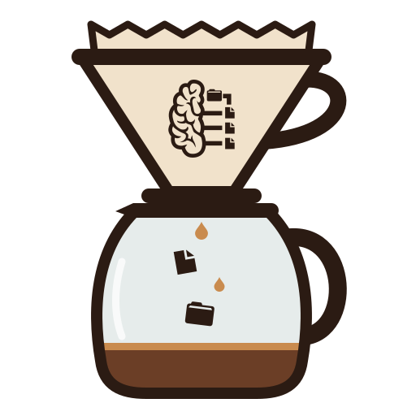

<p align="center">
  
</p>

# brainfilter

Build, read and filter BIDS datasets on any storage backend.

`brainfilter` walks a BIDS dataset, local or remote, exposes its files and
their metadata as Python objects, and selects files by subject, session,
datatype, suffix, any BIDS entity, glob or regex. It keeps the sidecars
and companion files that apply to what you select, so you can filter a
large remote dataset and download only what you need.

**Documentation: <https://balbasty.github.io/brainfilter/>**

## Installation

```shell
pip install brainfilter
```

Remote paths (`s3://`, `gs://`, `https://`, ...) need a backend:
[universal-pathlib](https://github.com/fsspec/universal-pathlib) plus the
fsspec package for your store (for example `pip install universal-pathlib
s3fs`), or [cloudpathlib](https://github.com/drivendataorg/cloudpathlib).
See [Installation](https://balbasty.github.io/brainfilter/getting-started/installation/).

## A first look

The example runs on a small dataset in memory (`memory://`); a local path
or an `s3://` URL works the same way.

```python
from brainfilter import BidsPath

ds = BidsPath("memory://ds")                    # read-only by default
t1w = ds["sub-01"]["anat"]["sub-01_T1w.nii.gz"]
t1w.sidecar["RepetitionTime"]                   # merged sidecars, nearest first
ds["participants.tsv"]["age"]                   # one typed column of a table

kept = ds.filter(subjects=1, datatypes="anat")
[str(p.relative_to(ds)) for p in kept]          # the files and their sidecars

ds = ds.with_mode("w")                          # opt in to writing
with ds:                                        # written together on exit
    ds["sub-01"]["anat"]["sub-01_T1w.json"]["RepetitionTime"] = 2.3
    ds["participants.tsv"]["handedness"] = ["R", "L"]
```

## Learn more

- [First steps](https://balbasty.github.io/brainfilter/getting-started/first-steps/):
  opening a dataset, reading sidecars and tables, a first filter.
- [Filtering a local dataset](https://balbasty.github.io/brainfilter/tutorials/filter-local/)
  and [a remote one on S3](https://balbasty.github.io/brainfilter/tutorials/filter-remote/).
- [Editing a dataset safely](https://balbasty.github.io/brainfilter/tutorials/edit-dataset/):
  read-only paths, write-through and transactions.
- [API reference](https://balbasty.github.io/brainfilter/api/paths/).

## Artwork

The logo and site icon (`docs/images/`) are generated by
`tools/artwork/make_logos.py` (the PNG icons by `tools/artwork/render_pngs.js`,
with Node and Playwright). The BIDS mark, file and folder glyphs are adapted
from the [BIDS logo](https://github.com/bids-standard/bids-specification/tree/master/BIDS_logo)
(CC BY 4.0).
